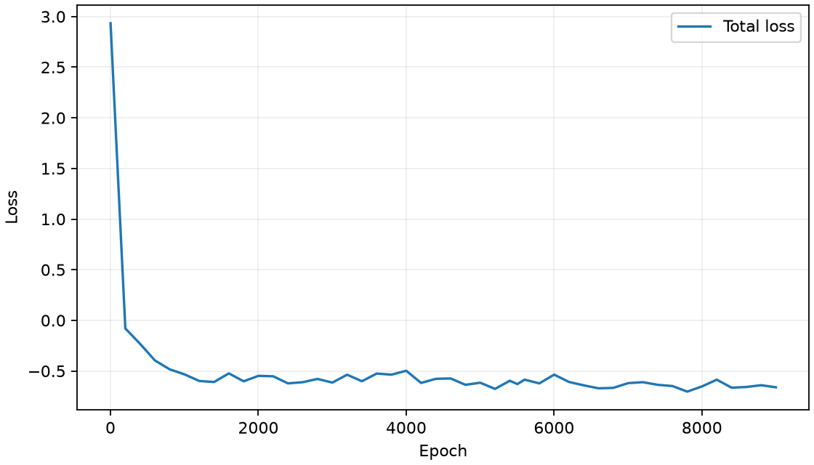

# Bosonic six-point neural search

Objective: discover new six-point overlap relations through neural search, numerical validation and analysis of the underlying physical equations.
Numerically verified candidate relations: 8.
Literature comparison: 8 candidate relations pending equation-by-equation review.

Profiles: matter s; gravity u, v, w; 84 external-profile sectors; 396 terms per sector.
The search constructs overlap-integral identities within each external-profile sector.
Training includes allowed mode-zero states and the radion. Candidate validation includes independent zero-mode checks.
Training: 9000 steps, 293.91 seconds.
Data generation, search and verification time: 314.89 seconds.
First successful proposal: categorical_sample.

Notation: mass labels M0...M5 index external slots from zero; field labels 1...6 index them from one. Derivatives and masses are dimensionless.
Zero-mode validation checks the floored absolute residual and records identically vanishing rows separately.

## Candidate C1: ssssww

Analytical structure: exact linear combination of projections of the published mode equations.

```text
+1*C3[s1 s2 d_s3 s4 d_w5 w6] +1*b*b*C5[s1 s2 s3 s4 w5 w6] +1*C3[s1 s2 d_s3 d_s4 w5 w6] +1*C3[d_s1 s2 d_s3 s4 w5 w6] +1*C3[s1 s2 d_s3 s4 w5 d_w6] +1*C3[s1 d_s2 d_s3 s4 w5 w6] -1*M2*M2*C3[s1 s2 s3 s4 w5 w6] = 0
```

| Check | Max relative residual | Active fraction | Passed |
|---|---:|---:|---|
| validation | 5.576e-12 | 1.000 | True |
| test_iid | 2.772e-11 | 1.000 | True |
| test_ood | 4.873e-13 | 1.000 | True |
| test_modes | 8.613e-13 | 1.000 | True |
| independent | 3.702e-12 | 1.000 | True |
| zero_modes | 1.313e-11 | 1.000 | True |

## Candidate C2: ssssuw

Analytical structure: exact linear combination of projections of the published mode equations.

```text
+1*C3[s1 s2 d_s3 s4 d_u5 w6] +1*b*b*C5[s1 s2 s3 s4 u5 w6] +1*C3[s1 s2 d_s3 d_s4 u5 w6] +1*C3[d_s1 s2 d_s3 s4 u5 w6] +1*C3[s1 s2 d_s3 s4 u5 d_w6] +1*C3[s1 d_s2 d_s3 s4 u5 w6] -1*M2*M2*C3[s1 s2 s3 s4 u5 w6] = 0
```

| Check | Max relative residual | Active fraction | Passed |
|---|---:|---:|---|
| validation | 4.170e-12 | 1.000 | True |
| test_iid | 3.303e-11 | 1.000 | True |
| test_ood | 5.034e-13 | 1.000 | True |
| test_modes | 1.325e-12 | 1.000 | True |
| independent | 4.219e-12 | 1.000 | True |
| zero_modes | 1.095e-11 | 1.000 | True |

## Candidate C3: ssuwww

Analytical structure: exact linear combination of projections of the published mode equations.

```text
+1*C3[s1 s2 d_u3 w4 d_w5 w6] +1*C3[s1 s2 d_u3 d_w4 w5 w6] +1*C3[d_s1 s2 d_u3 w4 w5 w6] +1*C3[s1 s2 d_u3 w4 w5 d_w6] +1*C3[s1 d_s2 d_u3 w4 w5 w6] -1*M2*M2*C3[s1 s2 u3 w4 w5 w6] = 0
```

| Check | Max relative residual | Active fraction | Passed |
|---|---:|---:|---|
| validation | 6.036e-13 | 0.833 | True |
| test_iid | 6.328e-13 | 0.875 | True |
| test_ood | 5.449e-13 | 0.847 | True |
| test_modes | 1.755e-12 | 0.903 | True |
| independent | 6.338e-13 | 0.903 | True |
| zero_modes | 2.694e-12 | 0.833 | True |

## Candidate C4: ssssuv

Analytical structure: exact linear combination of projections of the published mode equations.

```text
+1*C3[s1 s2 d_s3 s4 d_u5 v6] +1*b*b*C5[s1 s2 s3 s4 u5 v6] +1*C3[s1 s2 d_s3 d_s4 u5 v6] +1*C3[d_s1 s2 d_s3 s4 u5 v6] +1*C3[s1 s2 d_s3 s4 u5 d_v6] +1*C3[s1 d_s2 d_s3 s4 u5 v6] -1*M2*M2*C3[s1 s2 s3 s4 u5 v6] = 0
```

| Check | Max relative residual | Active fraction | Passed |
|---|---:|---:|---|
| validation | 1.182e-12 | 1.000 | True |
| test_iid | 1.633e-12 | 1.000 | True |
| test_ood | 5.403e-13 | 1.000 | True |
| test_modes | 1.517e-12 | 1.000 | True |
| independent | 4.403e-12 | 1.000 | True |
| zero_modes | 7.322e-12 | 1.000 | True |

## Candidate C5: ssssvw

Analytical structure: exact linear combination of projections of the published mode equations.

```text
+1*C3[s1 s2 d_s3 s4 d_v5 w6] +1*b*b*C5[s1 s2 s3 s4 v5 w6] +1*C3[s1 s2 d_s3 d_s4 v5 w6] +1*C3[d_s1 s2 d_s3 s4 v5 w6] +1*C3[s1 s2 d_s3 s4 v5 d_w6] +1*C3[s1 d_s2 d_s3 s4 v5 w6] -1*M2*M2*C3[s1 s2 s3 s4 v5 w6] = 0
```

| Check | Max relative residual | Active fraction | Passed |
|---|---:|---:|---|
| validation | 3.165e-12 | 1.000 | True |
| test_iid | 3.690e-12 | 1.000 | True |
| test_ood | 8.896e-13 | 1.000 | True |
| test_modes | 3.591e-12 | 1.000 | True |
| independent | 2.784e-12 | 1.000 | True |
| zero_modes | 1.097e-11 | 1.000 | True |

## Candidate C6: ssuvvw

Analytical structure: exact linear combination of projections of the published mode equations.

```text
+1*C3[s1 s2 d_u3 v4 d_v5 w6] +1*C3[s1 s2 d_u3 d_v4 v5 w6] +1*C3[d_s1 s2 d_u3 v4 v5 w6] +1*C3[s1 s2 d_u3 v4 v5 d_w6] +1*C3[s1 d_s2 d_u3 v4 v5 w6] -1*M2*M2*C3[s1 s2 u3 v4 v5 w6] = 0
```

| Check | Max relative residual | Active fraction | Passed |
|---|---:|---:|---|
| validation | 1.380e-12 | 0.819 | True |
| test_iid | 9.594e-13 | 0.875 | True |
| test_ood | 9.929e-13 | 0.875 | True |
| test_modes | 9.642e-13 | 0.861 | True |
| independent | 5.489e-13 | 0.861 | True |
| zero_modes | 8.655e-13 | 0.656 | True |

## Candidate C7: ssuuuv

Analytical structure: exact linear combination of projections of the published mode equations.

```text
+1*C3[s1 s2 d_u3 u4 d_u5 v6] +1*C3[s1 s2 d_u3 d_u4 u5 v6] +1*C3[d_s1 s2 d_u3 u4 u5 v6] +1*C3[s1 s2 d_u3 u4 u5 d_v6] +1*C3[s1 d_s2 d_u3 u4 u5 v6] -1*M2*M2*C3[s1 s2 u3 u4 u5 v6] = 0
```

| Check | Max relative residual | Active fraction | Passed |
|---|---:|---:|---|
| validation | 9.460e-13 | 0.833 | True |
| test_iid | 4.942e-13 | 0.819 | True |
| test_ood | 4.360e-13 | 0.875 | True |
| test_modes | 1.136e-12 | 0.917 | True |
| independent | 9.543e-13 | 0.917 | True |
| zero_modes | 1.114e-12 | 0.800 | True |

## Candidate C8: ssuuuu

Analytical structure: exact linear combination of projections of the published mode equations.

```text
+1*C3[s1 s2 d_u3 u4 d_u5 u6] +1*C3[s1 s2 d_u3 d_u4 u5 u6] +1*C3[d_s1 s2 d_u3 u4 u5 u6] +1*C3[s1 s2 d_u3 u4 u5 d_u6] +1*C3[s1 d_s2 d_u3 u4 u5 u6] -1*M2*M2*C3[s1 s2 u3 u4 u5 u6] = 0
```

| Check | Max relative residual | Active fraction | Passed |
|---|---:|---:|---|
| validation | 6.574e-13 | 0.847 | True |
| test_iid | 5.242e-13 | 0.903 | True |
| test_ood | 5.124e-13 | 0.917 | True |
| test_modes | 5.671e-12 | 0.931 | True |
| independent | 6.084e-12 | 0.931 | True |
| zero_modes | 6.260e-12 | 0.833 | True |


